<h1 align="center">Hey, I'm Skonester.</h1>

  Media players. Desktop apps. A soft spot for F# and V.

  <a href="https://github.com/skonester?tab=repositories">Explore my projects</a>
  &nbsp;&middot;&nbsp;
  <a href="https://github.com/skonester/CedarApple">Check out CedarApple</a>

<!-- cool-readme:start -->

  <picture>
    <source media="(prefers-color-scheme: dark)" srcset="stats/about-dark.svg">
    
  </picture>
  <picture>
    <source media="(prefers-color-scheme: dark)" srcset="https://raw.githubusercontent.com/skonester/skonester/refs/heads/main/stats/languages-dark.svg">
    
  </picture>

  <picture>
    <source media="(prefers-color-scheme: dark)" srcset="stats/summary-dark.svg">
    
  </picture>
  <picture>
    <source media="(prefers-color-scheme: dark)" srcset="stats/weekly-dark.svg">
    
  </picture>

<!-- cool-readme:end -->

## On my workbench

### [HeapSeed](https://github.com/skonester/HeapSeed)

A desktop BitTorrent client with MP4 playback while downloads are still in progress. Built with Electron, WebTorrent, Svelte, and Plyr.

I'm interested in the details that make media software feel good to use: playback, streaming, and the interface around them.

---

Behind this profile

These SVG cards are generated from my public GitHub activity by the TypeScript code in this repository. They adapt to light and dark themes and refresh daily with [GitHub Actions](https://github.com/skonester/skonester/actions/workflows/cool-readme.yml).

The initial cards show a pending state until the first workflow run; no example statistics are presented as mine.

Card settings live in [cool-readme.yml](cool-readme.yml). See the [profile setup guide](docs/profile-setup.md) for local previews and customization, or the [original generator documentation](docs/generator.md) for every option.

Powered by [github-cool-readme](https://github.com/pedrocatalao/github-cool-readme) by Pedro Catalão, under the [MIT license](LICENSE).

